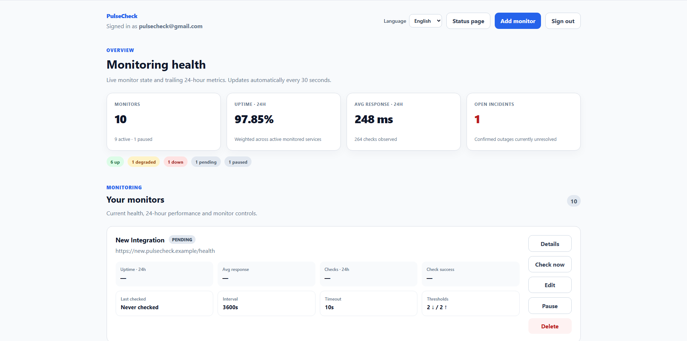
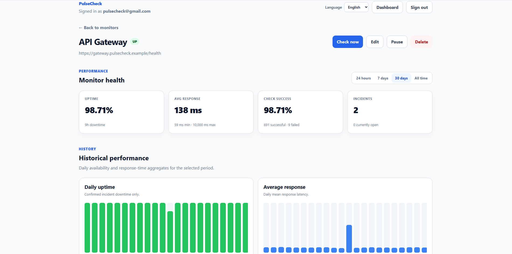
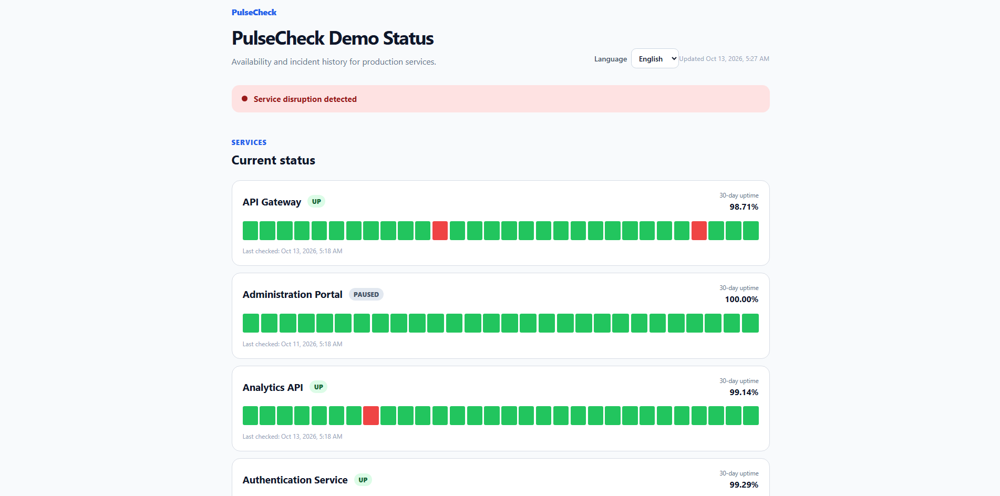
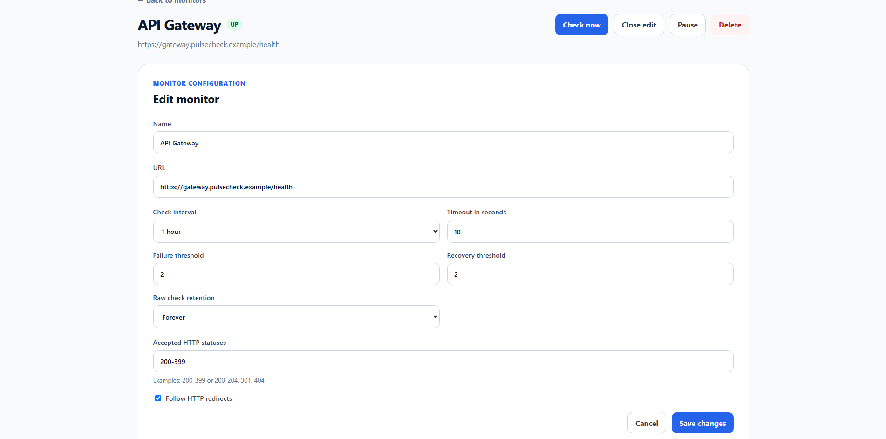
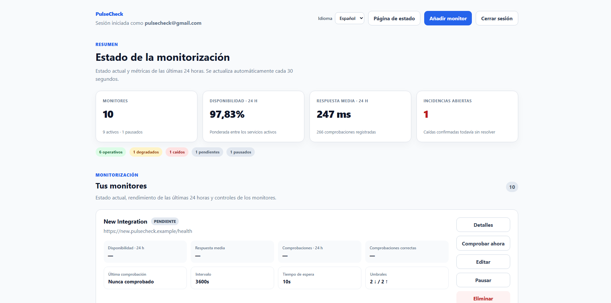


<div align="center">

# PulseCheck

### HTTP uptime monitoring with incident tracking and historical metrics

<p>
  A full-stack monitoring application built with Django REST Framework,
  React, TypeScript, PostgreSQL, Redis and Celery.
</p>

<p>
  <a href="https://github.com/blesa03/PulseCheck/actions/workflows/ci.yml">
    
  </a>
  
  
  
  
</p>

<p>
  
  
  
  
</p>

<p>
  <strong>HTTP checks</strong> ·
  <strong>Incident tracking</strong> ·
  <strong>Historical metrics</strong> ·
  <strong>Public status pages</strong> ·
  <strong>JWT authentication</strong> ·
  <strong>i18n</strong>
</p>

<br>



<sub>Dashboard populated with synthetic demonstration data.</sub>

</div>

---

## What is PulseCheck?

**PulseCheck** is a self-hostable application for monitoring the availability
and response times of HTTP services.

Users can configure monitors, schedule periodic HTTP checks, inspect their
results, review incidents and explore historical performance. Selected services
can also be exposed through a public status page without disclosing their
private monitoring configuration.

The project focuses on more than simply sending HTTP requests. It explores
how background jobs, state transitions, data retention, concurrency control,
security restrictions and historical analytics can work together in a
consistent monitoring system.

## Features

| Area | Capabilities |
|---|---|
| HTTP monitoring | Configurable intervals, timeouts, accepted status codes and redirect handling |
| State engine | UP, DEGRADED, DOWN and PAUSED states, plus monitors awaiting their first check |
| Incident tracking | Confirmed outages, recovery thresholds, open and resolved incidents |
| Historical analytics | Uptime, successful checks, response times and daily history |
| Data retention | 48 hours, 7 days, 14 days, 30 days or indefinite raw-check retention |
| Dashboard | Aggregate health indicators, monitor actions and automatic refresh |
| Monitor details | Configuration, metrics, history, recent checks and incident timeline |
| Public status pages | Selected monitors, overall service health and recent incidents |
| Authentication | Email/password authentication with access and rotating refresh tokens |
| Internationalization | English and Spanish frontend interfaces |
| Engineering | Automated testing, CI, Docker development and production configuration |

## Screenshots

The screenshots use a reproducible, synthetic dataset generated by
`seed_demo`. They illustrate the application without representing measurements
from real production services.

<table>
  <tr>
    <td width="50%" valign="top">
      
      <p align="center"><strong>Monitor details</strong></p>
      <p align="center">Historical metrics, recent checks and incidents.</p>
    </td>
    <td width="50%" valign="top">
      
      <p align="center"><strong>Public status page</strong></p>
      <p align="center">Public service health without private configuration.</p>
    </td>
  </tr>
  <tr>
    <td width="50%" valign="top">
      
      <p align="center"><strong>Monitor configuration</strong></p>
      <p align="center">Intervals, thresholds, retention and HTTP behavior.</p>
    </td>
    <td width="50%" valign="top">
      
      <p align="center"><strong>English and Spanish</strong></p>
      <p align="center">Localized interface, states and date formatting.</p>
    </td>
  </tr>
</table>

## Technology stack

| Layer | Technologies |
|---|---|
| Backend | Python 3.13, Django 5.2, Django REST Framework |
| Frontend | React 19, TypeScript, Vite, React Router |
| Database | PostgreSQL 18 |
| Background processing | Celery 5.6, Redis |
| HTTP checks | HTTPX |
| Authentication | JWT, PyJWT, HttpOnly refresh cookies |
| Production serving | Gunicorn, Nginx, WhiteNoise |
| Backend quality | pytest, pytest-django, Ruff |
| Frontend quality | Vitest, React Testing Library, ESLint, TypeScript |
| Infrastructure | Docker Compose, GitHub Actions |

## Architecture overview

```text
                     Browser
                        |
                 React + TypeScript
                        |
                  REST API /api/
                        |
                Django REST Framework
                  /       |       \
            PostgreSQL   Redis   Celery
                |          |       |
             Monitors   Shared   Worker
             Checks     cache      |
             Incidents             |
             Daily metrics    HTTP checks
                                  |
                           External services

                     Celery Beat
                         |
                  Scheduled dispatch
```

PostgreSQL is the source of truth for monitors, check results, incidents
and historical metrics. Redis supports the Celery queue and shared API
throttling. Celery Beat schedules work, while workers execute checks.

The React frontend consumes the API but does not calculate or persist the
authoritative monitoring state.

For the complete system design, see [Architecture and API](docs/architecture.md).

## Key engineering decisions

### Confirmed incidents, not isolated failures

A single failed request does not necessarily represent an outage.

PulseCheck uses configurable failure and recovery thresholds to distinguish
transient problems from confirmed service interruptions. Incidents are
created and resolved through those transitions.

### Consistent history and retention

Individual HTTP results are stored separately from daily aggregates.

This allows raw observations to be deleted according to each monitor's
retention policy without discarding its daily historical metrics.

Uptime is calculated from confirmed incident duration, not simply from the
percentage of successful HTTP requests.

### Safe HTTP destinations

Monitoring arbitrary user-provided URLs creates SSRF risks.

PulseCheck restricts monitoring targets to public HTTP/HTTPS destinations,
checks DNS resolutions, pins the vetted destination for the connection and
validates redirects separately.

### Concurrency-aware updates

Checks can finish after a monitor has been paused or reconfigured.

Configuration versions, row locking and timestamp checks prevent obsolete
results from overwriting newer monitoring state.

### Public/private data separation

Authenticated users manage their own monitors and configuration.

Public status pages expose selected service health and incident information
without exposing private URLs or monitoring parameters.

## Run locally

**Requirements:** Docker Engine and Docker Compose.

From the repository root:

```powershell
Copy-Item .env.example .env
docker compose up -d --build
docker compose ps
```

Review `.env` before starting, especially its development secrets and
database settings.

| Service | Address |
|---|---|
| React frontend | http://localhost:5173 |
| Django API | http://localhost:8000/api/ |
| Health check | http://localhost:8000/api/health/ |
| Readiness check | http://localhost:8000/api/health/ready/ |

The development backend applies migrations automatically when the container
starts.

Register through `/register` or generate the isolated demonstration account
described below.

For environment variables, troubleshooting and production deployment,
see [Development and deployment](docs/production.md).

## Synthetic demo dataset

A development-only management command generates a monitoring scenario
for local exploration and portfolio screenshots.

The dataset contains:

- Nine example monitors with different states.
- Up to 30 days of hourly HTTP observations.
- Daily aggregates calculated from those observations.
- Open and resolved incidents.
- Synthetic monitoring history available through the existing account.

The command uses the existing `pulsecheck@gmail.com` account.
That account must already exist in the development database.

Run:

```powershell
docker compose exec backend python manage.py seed_demo
```

Sign in as `pulsecheck@gmail.com` using the account's existing password.

The command reuses the account's public status page if one exists.
If no page exists, it creates one using the `pulsecheck-demo` slug.

Check the actual public page URL in the command output.
An existing disabled page must be enabled through the application
before it can be viewed anonymously.

To regenerate the synthetic dataset:

```powershell
docker compose exec backend python manage.py seed_demo --reset
```

The reset operation removes recognized synthetic monitors and rebuilds
their history. It does not delete the user, change its password, or
remove unrelated monitors.

The command refuses to run with `DEBUG=False`, does not perform
external HTTP requests, and leaves synthetic monitors unscheduled.

**Synthetic data must not be presented as actual production history.**

## Testing

Backend:

```powershell
docker compose exec backend ruff check .
docker compose exec backend ruff format --check .
docker compose exec backend pytest -q
```

Frontend:

```powershell
docker compose exec frontend npm run lint
docker compose exec frontend npm test
docker compose exec frontend npm run build
```

GitHub Actions runs automated backend and frontend checks for pushes and
pull requests targeting `main`.

The existing suites cover authentication, permissions, monitoring states,
retention, metrics, public status pages, security restrictions and several
frontend workflows. They do not constitute a complete production security
audit or exhaustive end-to-end test suite.

## Documentation

- [Architecture, data model and API](docs/architecture.md)
- [Development, production deployment and operations](docs/production.md)

## Project scope

PulseCheck is an MVP and a software engineering portfolio project.

It demonstrates a monitoring architecture, rather than attempting to replace
a commercial observability platform. Features such as alert delivery,
distributed high availability and external infrastructure provisioning are
outside the current scope.

The production Compose configuration provides a deployable single-host
foundation, but operating a public instance still requires HTTPS
termination, backup procedures, security configuration and operational
monitoring.

---

<div align="center">

**PulseCheck — HTTP monitoring with deliberate attention to consistency,
security and maintainability.**

</div>
